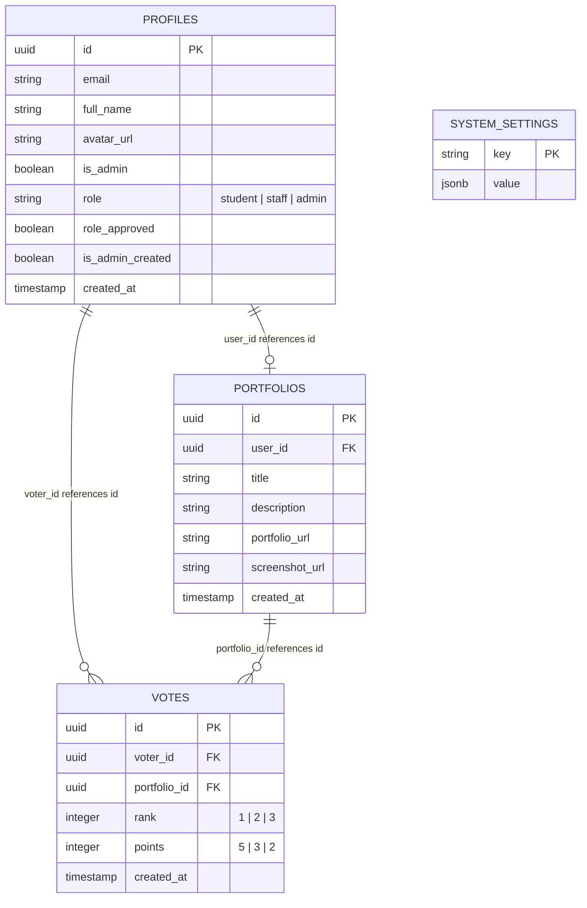

# Developer Reference Guide

This document provides a technical overview of the **DreamSpace Portfolio Voting System** codebase, database schema, security rules, and testing standards.

---

## 🛠️ Technology Stack
- **Frontend:** React (Vite)
- **Styling:** Vanilla CSS Custom Properties (Light Theme Only)
- **Backend-as-a-Service:** Supabase (PostgreSQL + Supabase Auth)
- **Hosting:** Vercel

---

## 🗄️ Database Architecture

The PostgreSQL schema is structured around four primary tables and two aggregate views designed to protect voter anonymity.



### Aggregate Views & Anonymity
To comply with the requirement of strict voter privacy, individual ballots are shielded at the database layer. Monitoring panels and scoreboards read only from pre-aggregated, read-only views:

1. **`public.voting_stats` (Staff/Admin Only):**
   - Renders aggregate system engagement: total voter headcount, total portfolios uploaded, and voter turnout percentage.
   - Excludes student UUIDs and individual selection details.

2. **`public.results_view` (All Approved Roles):**
   - Serves the scoreboard. Returns only the fields: `portfolio title` and `total_points`.
   - Ordered by `total_points DESC` where:
     $$\text{Score} = (Rank_1 \times 5) + (Rank_2 \times 3) + (Rank_3 \times 2)$$

---

## 🔐 Row Level Security (RLS) Policies

Row Level Security is enabled on all tables in Supabase to enforce access boundaries:

- **Profiles:**
  - *Select:* Approved users can view profiles. Unapproved users can only view their own profile.
  - *Insert/Update:* Users can only edit/insert their own profile details. Admins can update any profile (to toggle approvals). The flags `is_admin` and `is_admin_created` cannot be modified by non-admin users.
- **Portfolios:**
  - *Select:* Approved Students, Staff, and Admins can view portfolio links. Unapproved roles are blocked.
  - *Insert/Update:* Restricted strictly to profiles where `role = 'student'` and `role_approved = true`.
- **Votes:**
  - *Select:* **Only the owner of the ballot (`auth.uid() = voter_id`) can select/read their own row.**
  - *Strict Restriction:* Direct SELECT commands on the `votes` table are denied to all other users—including Staff and Administrators. Staff and Admins are blocked from seeing raw ballots, even via backend logs.
  - *Insert/Update:* Restricted to approved Students, and only active when the global `results_released` flag is set to `false`.

---

## 💻 Frontend Design Architecture

The client-side is structured as a React Single Page Application (SPA). Styling is managed entirely with custom CSS variables declared in `src/index.css`.

### Theme & Aesthetics Variables
```css
:root {
  --color-primary: #7B1FA2;       /* Deep Purple */
  --color-primary-light: #F3E5F5; /* Very Light Violet */
  --color-accent: #FF6F00;        /* Accent Orange */
  --color-accent-light: #FFF3E0;  /* Very Light Orange */
  
  --color-bg-base: #FDFBFD;       /* Premium off-white background */
  --color-bg-card: #FFFFFF;       /* Pure white card backgrounds */
  --color-text-main: #212121;     /* Charcoal for readability */
}
```

### Screen Flow & Routing Logic
- **Authentication Guard:** Restricts access based on the Supabase JWT token state.
- **Onboarding Guard:** Triggers role selection if a Google OAuth user lacks a database profile.
- **Approval Guard:** Displays the pending message for Staff accounts where `role_approved = false`.
- **Admin Routing:** Sends verified administrator logins (`is_admin = true`) directly to the configuration control panel.

---

## 🧪 Testing Checklists

Developers and QA testers should validate the system using the following checklists:

### 1. Security & Constraints
- [ ] Attempting Google OAuth login with a non `@dreamspace.academy` domain displays the domain warning message.
- [ ] Attempting to write a ballot when `results_released = true` is blocked on the database.
- [ ] Querying `votes` directly from a staff or administrator session returns only the active user's own rows, if any.
- [ ] Attempting to upload a second portfolio for a single student profile throws a database constraint exception.

### 2. User Experience & Flows
- [ ] Student onboarding displays the Student Dashboard immediately on submission.
- [ ] Staff onboarding correctly redirects to the "Pending Approval" view.
- [ ] Adding or removing candidates in the ballot drawer renders the slide-up and slide-down transitions.
- [ ] The Leaderboard is hidden from general users until the administrator toggles the settings button.
