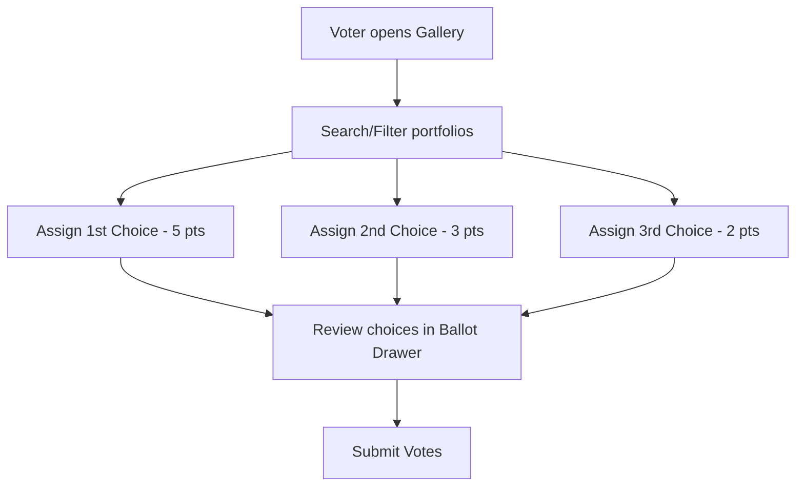

# Student User Guide

As a Student of DreamSpace Academy, you have the opportunity to showcase your portfolio project to your peers and cast your vote in the portfolio competition.

---

## 🔑 Step 1: Logging In
When you open the application, you will see a unified Login Screen:

1. **Google OAuth Login:**
   - Click the **"Sign in with Google"** button.
   - Enter your `@dreamspace.academy` account credentials.
   - *Note: Non-domain Google accounts will be automatically rejected.*

2. **Credentials Login (Username & Password):**
   - If you do not have a `@dreamspace.academy` email, you must use credentials provisioned for you by an Administrator.
   - Input your email/username and password in the provided fields, and click **"Login"**.
   - These credentials automatically bypass the domain checks and route you directly to the Student Dashboard.

---

## 🚀 Step 2: Role Onboarding (Google Users Only)
If this is your first time logging in using Google OAuth, you will be prompted with a **Role Selection** modal:
- Click **"Student"** to complete registration.
- Your student profile is approved immediately, routing you directly to your Student Dashboard.
- *(Staff members are put in a pending state, and admins are pre-configured, so be sure to choose Student if you are a candidate/voter).*

---

## 💻 Step 3: Portfolio Submission & Management
Before your peers can vote for you, you need to register your portfolio site.

1. **Locate the Submission Panel:** Navigate to the portfolio form on your dashboard.
2. **Fill in the Details:**
   - **Title:** The name of your portfolio project (e.g., *Jane's Web Showcase*).
   - **Description:** A short summary of your project, the tech stack, or your design inspiration.
   - **Portfolio URL:** The live web link to your site. This must start with `https://`.
3. **Save/Update:** Click submit to upload your portfolio. You can edit your portfolio title, description, or URL at any time prior to the close of voting.
   - *Note: Only one portfolio can be submitted per student profile.*

---

## 🗳️ Step 4: Casting Your Ranked-Choice Ballot
Once portfolios are submitted, the Voting Gallery is opened. You can cast exactly three ranked votes.

### Navigating the Gallery
- Use the **Search Bar** to search for portfolios by project title or candidate name.
- Explore portfolio cards. Hovering over cards lifts them slightly to reveal detail previews.

### Selecting Your Choices
- On each portfolio card, click the dropdown or button to assign a rank: **1st Choice**, **2nd Choice**, or **3rd Choice**.
- A sticky **"My Ballot"** drawer will slide up from the bottom of the screen to track your current selections:
  - **1st Choice (5 Points)**
  - **2nd Choice (3 Points)**
  - **3rd Choice (2 Points)**
- You can change or remove selections directly in the drawer.
- **Constraints:**
  - You cannot vote for the same portfolio in multiple ranks.
  - You are permitted to vote for your own portfolio.
  - Voting must be completed before the Administrator releases the final results.

### Submitting the Ballot
- When satisfied with your choices, click **"Submit Votes"** inside the Ballot Drawer to save your vote securely.

---

## 🏆 Step 5: Viewing the Scoreboard
After the voting period ends, the Administrator will release the scores.

- Once released, a **Leaderboard** tab will appear on your homepage.
- The leaderboard ranks portfolios from highest points to lowest points.
- **Privacy Assurance:** Only the portfolio titles and their total points are rendered. Your individual selections, as well as those of other students, are completely anonymous and cannot be seen by anyone.
