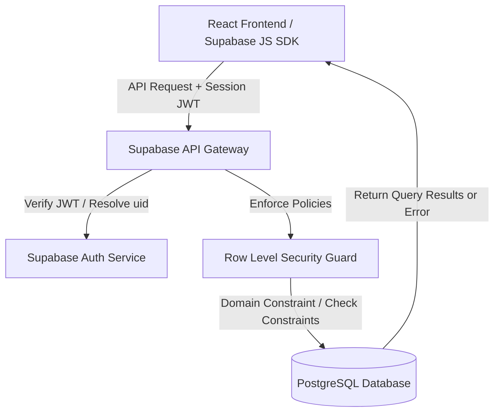
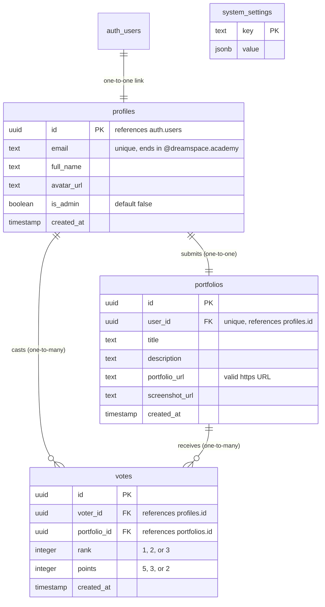

# API DOCUMENTATION

## Overview

This document provides a comprehensive developer-ready guide for calling, modifying, and understanding the backend API of the **DreamSpace Portfolio Voting System**. 

The backend architecture is built entirely on **Supabase** (PostgreSQL database, authentication service, and storage) with **Row Level Security (RLS)** acting as the primary gatekeeper.

The application contains four core tables/services:
1. **Profiles** (`profiles`): Manages user identity, domain matching, and access levels (Voter, Monitoring Staff, Admin).
2. **Portfolios** (`portfolios`): Stores student applications, site URLs, and descriptions.
3. **Votes** (`votes`): Tallies ranked votes anonymously (1st Choice = 5pts, 2nd Choice = 3pts, 3rd Choice = 2pts).
4. **System Settings** (`system_settings`): Configures global application flags, such as toggling active voting periods or releasing results.

---

## Architecture Flow

The data and security flow is structured as a direct client-to-database connection, secure and isolated via JWTs:



1. **Authentication**: The frontend requests authentication from Supabase Auth (via Google OAuth or email credentials).
2. **Session Token**: Once authenticated, the Supabase client automatically attaches the user's JSON Web Token (JWT) to every database request.
3. **API Routing**: Requests to read or modify data hit Supabase REST endpoints (powered by PostgREST).
4. **RLS Authorization**: PostgreSQL intercepts the request, runs the defined policies against `auth.uid()`, and ensures users can only read or write rows they are authorized to access.
5. **Database constraints**: Enforces field validation rules (e.g. domain checks, unique rank rules) at the database engine level.

---

## Authentication

Authentication is domain-locked. Only users with `@dreamspace.academy` emails are allowed to enter the ecosystem.

### Google OAuth Flow
The primary login mechanism uses Google Sign-In. 
1. **Client-side Domain Validation**: Upon login redirect, the React frontend inspects `user.email` and immediately calls `signOut()` if it does not end with `@dreamspace.academy`.
2. **Database-side Domain Validation**: The `profiles` table has a Postgres CHECK constraint:
   ```sql
   constraint dreamspace_email_check check (email like '%@dreamspace.academy')
   ```
   This prevents unauthorized users from bypassing the UI and manually inserting records via direct API requests.

### Sign-In Methods (SDK Examples)

#### 1. Google OAuth
Redirects the client to Google's sign-in screen:
```javascript
import { createClient } from '@supabase/supabase-js';

const supabaseUrl = import.meta.env.VITE_SUPABASE_URL;
const supabaseAnonKey = import.meta.env.VITE_SUPABASE_ANON_KEY;
export const supabase = createClient(supabaseUrl, supabaseAnonKey);

export async function signInWithGoogle() {
  const { data, error } = await supabase.auth.signInWithOAuth({
    provider: 'google',
    options: {
      redirectTo: window.location.origin,
    },
  });
  if (error) throw error;
  return data;
}
```

#### 2. Secure Email & Password Login (Bypass / Admin / Local Testing)
Used by administrators or staff accounts which might use pre-configured bypass credentials:
```javascript
export async function signInWithCredentials(email, password) {
  const { data, error } = await supabase.auth.signInWithPassword({
    email,
    password,
  });
  if (error) throw error;
  return data;
}
```

#### 3. Sign Out
```javascript
export async function logOut() {
  const { error } = await supabase.auth.signOut();
  if (error) throw error;
}
```

---

## API Usage (CRUD examples)

All operations are executed via the official `@supabase/supabase-js` library.

### 1. Fetching Portfolios (Read)
Retrieve all portfolios registered in the system to display them in the candidate gallery:
```javascript
export async function getPortfolios() {
  const { data, error } = await supabase
    .from('portfolios')
    .select(`
      id,
      title,
      description,
      portfolio_url,
      screenshot_url,
      profiles (
        full_name,
        avatar_url
      )
    `);
  if (error) {
    console.error('Error fetching portfolios:', error.message);
    return [];
  }
  return data;
}
```

### 2. Creating a Portfolio Profile (Create)
Allows a logged-in student to register their application link:
```javascript
export async function uploadPortfolio({ title, description, url }) {
  const { data: { user } } = await supabase.auth.getUser();
  if (!user) throw new Error('User session not found');

  const { data, error } = await supabase
    .from('portfolios')
    .insert([
      {
        user_id: user.id,
        title,
        description,
        portfolio_url: url,
      }
    ])
    .select();

  if (error) throw error;
  return data[0];
}
```

### 3. Modifying a Portfolio (Update)
Allows a student to modify their registered submission. Row Level Security limits updates to the portfolio owner:
```javascript
export async function updatePortfolio(portfolioId, updates) {
  const { data, error } = await supabase
    .from('portfolios')
    .update({
      title: updates.title,
      description: updates.description,
      portfolio_url: updates.url,
      screenshot_url: updates.screenshotUrl,
    })
    .eq('id', portfolioId)
    .select();

  if (error) throw error;
  return data[0];
}
```

### 4. Submitting or Modifying Votes (Create / Update / Delete)

Each student has exactly one ballot containing three ranked votes (Rank 1 = 5p, Rank 2 = 3p, Rank 3 = 2p).

#### Cast Ballot (Insert Votes)
When casting votes, we insert the choice objects. Use a single `.insert` array to save multiple rows in a transaction:
```javascript
export async function submitBallot(ballotSelections) {
  // ballotSelections format:
  // [
  //   { portfolio_id: '...', rank: 1, points: 5 },
  //   { portfolio_id: '...', rank: 2, points: 3 },
  //   { portfolio_id: '...', rank: 3, points: 2 }
  // ]
  const { data: { user } } = await supabase.auth.getUser();
  if (!user) throw new Error('Authentication required');

  const votesToInsert = ballotSelections.map(selection => ({
    voter_id: user.id,
    portfolio_id: selection.portfolio_id,
    rank: selection.rank,
    points: selection.points,
  }));

  const { data, error } = await supabase
    .from('votes')
    .insert(votesToInsert)
    .select();

  if (error) throw error;
  return data;
}
```

#### Update/Change Selections (Update Votes)
Update a single rank within the active ballot drawer:
```javascript
export async function updateVoteRank(voteId, newPortfolioId) {
  const { data, error } = await supabase
    .from('votes')
    .update({ portfolio_id: newPortfolioId })
    .eq('id', voteId)
    .select();

  if (error) throw error;
  return data[0];
}
```

#### Wipe Ballot (Delete Votes)
Delete current selections to reset choices:
```javascript
export async function resetBallot() {
  const { data: { user } } = await supabase.auth.getUser();
  if (!user) throw new Error('Authentication required');

  const { error } = await supabase
    .from('votes')
    .delete()
    .eq('voter_id', user.id);

  if (error) throw error;
}
```

---

## How to Modify / Replace Logic

As the application scales or details change, use the following rules to modify logic without breaking security or runtime status:

### 1. Renaming Tables Safely
If you need to rename a table (e.g., changing `portfolios` to `projects`):
1. **Database Migration**: Run a SQL migration script:
   ```sql
   alter table public.portfolios rename to projects;
   ```
2. **Update RLS Policies**: RLS policies are tied to the table. Renaming tables automatically keeps the policies, but any schema updates must target the new table name.
3. **Update Frontend Calls**: Globally replace the `.from('portfolios')` string in your code:
   ```javascript
   // Change this:
   supabase.from('portfolios')
   // To this:
   supabase.from('projects')
   ```

### 2. Modifying Queries under RLS Constraints
Developers do not need to append complex `.eq('user_id', auth.uid())` checks on every select query just for security. RLS automatically intercepts and filters data database-side. 
* *Safe Query Changes*: You can change columns retrieved, order, or joins.
* *Trap*: If you write a query that updates or deletes a row, and it succeeds in code but deletes 0 records, verify your RLS policy. RLS failures on write usually fail silently or return `401 / 403` status without crashing the client.

### 3. Switching Environments (.env Configuration)
Always load keys dynamically. Do NOT hardcode credentials.
1. Create a `.env` or `.env.local` file at the root:
   ```env
   VITE_SUPABASE_URL=https://your-project-id.supabase.co
   VITE_SUPABASE_ANON_KEY=your-anonymous-public-key
   ```
2. In production (e.g., Vercel / Netlify / AWS), load these environment variables in your deployment dashboard settings.

### 4. Schema Migration Guidelines
When adding new fields (e.g. `screenshot_url` to `portfolios`):
1. Add columns using a default value or nullable flag to avoid breaking current client calls.
2. In PostgreSQL:
   ```sql
   alter table public.portfolios add column screenshot_url text;
   ```
3. Update local TS interfaces or JS models to consume the new fields.

---

## Database & Supabase Structure

Here is the exact schema, relations, and table structure configured in Supabase PostgreSQL:



### Table Schema Summary

1. **`profiles`**
   * Maps 1:1 with Supabase Auth users.
   * `id` is a primary key linked to `auth.users.id` with `on delete cascade`.
   * Enforces `@dreamspace.academy` domain constraint at the database layer.

2. **`portfolios`**
   * Stores candidate submissions.
   * Unique constraint on `user_id` enforces a strict **one-portfolio-per-student** limit.

3. **`votes`**
   * Stores ranked-choice allocations.
   * Check constraint `rank_points_match` forces rank-to-point mappings:
     `Rank 1 -> 5 points`, `Rank 2 -> 3 points`, `Rank 3 -> 2 points`.
   * Unique constraint `unique_voter_rank` prevents double voting in the same rank category.
   * Unique constraint `unique_voter_portfolio` prevents casting multiple votes for the same candidate.

4. **`system_settings`**
   * Stores dynamic key-value parameters.
   * Default seeded row: `key = 'results_released'`, `value = false`.

---

## Security (RLS explanation)

Row Level Security (RLS) is enabled on every table. Below are the logical constraints protecting data visibility and changes:

| Table | Operation | Policy Rule (PostgreSQL SQL) | Explanation |
| :--- | :--- | :--- | :--- |
| **profiles** | SELECT | `true` (Public Auth) | Anyone logged in can read names and avatars. |
| **profiles** | INSERT/UPDATE | `auth.uid() = id` | A user can only write or edit their own profile metadata. |
| **portfolios**| SELECT | `true` (Public Auth) | All students/staff can browse candidate portfolios. |
| **portfolios**| ALL WRITES | `auth.uid() = user_id` | Students can only upload or update their own portfolio. |
| **votes** | SELECT | `auth.uid() = voter_id OR (select is_admin from profiles where id = auth.uid()) = true` | Prevents students from viewing other users' votes before results release (ensuring ballot integrity). Admins bypass. |
| **votes** | INSERT/UPDATE | `auth.uid() = voter_id AND (select (value->>'results_released')::boolean from system_settings where key = 'results_released') = false` | Users can cast/edit votes only while voting is open and results are not released. |
| **system_settings** | SELECT | `true` | Publicly readable so the app knows when to lock voting or show results. |
| **system_settings** | UPDATE | `(select is_admin from profiles where id = auth.uid()) = true` | Gated exclusively to users with `is_admin = true` inside the database. |

---

## MVP Improvements

As a startup CTO, here are the top 9 high-impact improvements to transform this from a basic MVP into a robust, high-performance, and secure product:

### 1. Implement PostgreSQL Trigger for Profile Synchronization
* **Problem**: Relying on the frontend code to insert into the `profiles` table right after OAuth login can lead to inconsistencies if a user closes the browser mid-operation.
* **Solution**: Create a database trigger on Supabase Auth. When a record is inserted into `auth.users`, a database trigger function automatically writes to `public.profiles`.
* **SQL Implementation**:
  ```sql
  create function public.handle_new_user()
  returns trigger as $$
  begin
    insert into public.profiles (id, email, full_name, avatar_url)
    values (
      new.id,
      new.email,
      new.raw_user_meta_data->>'full_name',
      new.raw_user_meta_data->>'avatar_url'
    );
    return new;
  end;
  $$ language plpgsql security definer;

  create trigger on_auth_user_created
    after insert on auth.users
    for each row execute procedure public.handle_new_user();
  ```

### 2. Expose Aggregated Scores via database VIEW or RPC (Database Function)
* **Problem**: Pulling all raw vote records to the client to calculate standard sums leaks candidate preferences and causes high bandwidth usage.
* **Solution**: Create an database View or RPC that returns point calculations directly, keeping individual vote rows hidden.
* **SQL Implementation**:
  ```sql
  create view public.portfolio_leaderboard as
  select 
    p.id as portfolio_id,
    p.title,
    p.portfolio_url,
    coalesce(sum(v.points), 0) as total_points
  from public.portfolios p
  left join public.votes v on p.id = v.portfolio_id
  group by p.id, p.title, p.portfolio_url;
  ```
  Enable SELECT on this view only when `system_settings.results_released = true`.

### 3. API Abstraction Service Layer (Repository Pattern)
* **Problem**: Scattering direct `supabase.from()` calls inside React UI components makes switching storage options or adding offline support difficult.
* **Solution**: Move all queries to a centralized service layer (e.g. `src/services/api.js`). React components should only invoke functional wrappers (e.g., `api.portfolios.list()`).

### 4. Enable Supabase Realtime Subscriptions
* **Problem**: Users must refresh the page manually to see if the admin has toggled voting on/off or released scores.
* **Solution**: Subscribe the client app to real-time events on the `system_settings` table to change views instantly.
  ```javascript
  const settingsSubscription = supabase
    .channel('system-settings-changes')
    .on('postgres_changes', { event: 'UPDATE', schema: 'public', table: 'system_settings' }, payload => {
      handleSettingsUpdate(payload.new);
    })
    .subscribe();
  ```

### 5. Client-Side Data Caching (React Query / SWR)
* **Problem**: React re-fetches portfolios and settings on every component mount, wasting API limits and slowing down navigation.
* **Solution**: Integrate **TanStack Query (React Query)** to cache API responses, adding automatic stale-while-revalidate states.

### 6. Centralized Error Boundary & Toast Feedback
* **Problem**: Raw database failures (like unique constraint violations) are printed to the console or crash the UI.
* **Solution**: Build a user-facing error parsing utility that translates Postgres codes (e.g., code `23505` for duplicate primary keys) into friendly user notifications like *"You have already cast a vote for this rank."*

### 7. Supabase Storage Integration for Screen Previews
* **Problem**: Users manually insert external layout image URLs, which leads to broken links and security layout shifts.
* **Solution**: Enable a Supabase Storage bucket (`portfolio-previews`). When uploading portfolios, users upload screenshots directly. The database stores the signed storage URL link.

### 8. Analytics Tracking & Audit Telemetry
* **Problem**: If anomalies occur during voting, admins have no trace of action histories.
* **Solution**: Create an audit logging table (`audit_logs`) writing logins, vote changes, and setting overrides via database functions.

### 9. Rate Limiting Auth and Operations
* **Problem**: Attackers could spam requests to register fake portfolios or exhaust database connections.
* **Solution**: Configure Supabase rate limit variables in the settings dashboard (limiting API request rates to 100 requests per minute) and proxy domain traffic through **Cloudflare** for DDOS shields.

---

## Final Notes for Developers

### Local Setup Checklist
1. Copy `.env.example` to `.env.local` and configure your credentials.
2. Run `npm install` followed by `npm run dev` to launch the dev server.
3. Database changes must be committed as schema SQL migration files under the `/supabase/migrations` folder—never modify tables directly in production via the Supabase dashboard GUI.

### Key Console Commands
* Run lint checks: `npm run lint`
* Build static package: `npm run build`
* Preview production build locally: `npm run preview`
