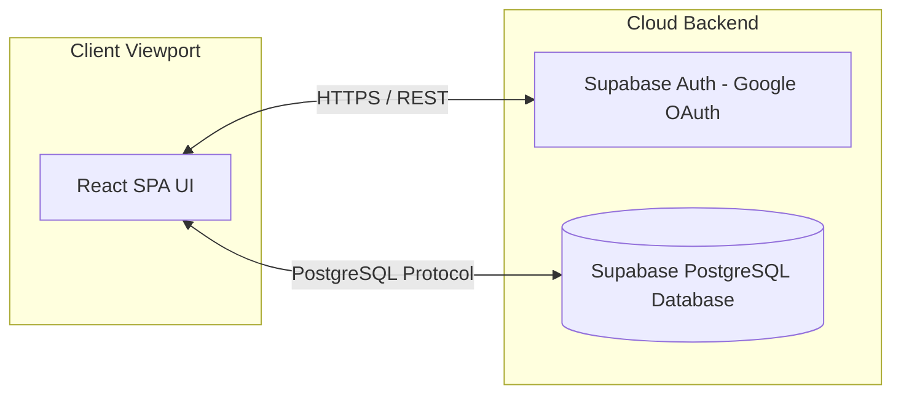

# IEEE Std 830-1998 Software Requirements Specification (SRS)
## Project: DreamSpace Portfolio Voting System

---

## 1. Introduction

### 1.1 Purpose
The purpose of this document is to define the complete software requirements for the **DreamSpace Portfolio Voting System**. This specification is intended for the project stakeholders, development team (database engineer, frontend developers), and the quality assurance tester.

### 1.2 Scope
This system manages the collection of portfolio websites submitted by students and staff of DreamSpace Academy and coordinates a 3-tier ranked voting process.
*   **Included:** Domain-locked Google OAuth authentication, portfolio submission/updating, ranked-choice ballot casting, admin toggle for results release, and dynamic responsive scoreboard display.
*   **Excluded:** Direct portfolio hosting (only URLs are collected), custom email registration (only Google accounts are supported).

### 1.3 Definitions, Acronyms, and Abbreviations
*   **IEEE:** Institute of Electrical and Electronics Engineers.
*   **SRS:** Software Requirements Specification.
*   **OAuth:** Open Authorization.
*   **RLS:** Row Level Security in PostgreSQL.
*   **Vite:** A frontend build tool that is lightweight and fast.
*   **Supabase:** Backend-as-a-Service using PostgreSQL.

### 1.4 References
*   IEEE Std 830-1998, IEEE Recommended Practice for Software Requirements Specifications.
*   Supabase JS Client SDK Reference.
*   DreamSpace Academy Brand Identity Manual (Colors: Purple and Orange).

### 1.5 Overview
The remainder of this document is organized into two main sections. Section 2 provides a high-level, overall description of the product perspective, functions, user characteristics, and design constraints. Section 3 outlines the specific functional, external interface, and non-functional requirements in detail.

---

## 2. Overall Description

### 2.1 Product Perspective
The DreamSpace Portfolio Voting System is a new, standalone web-based software product. It connects to a cloud database (Supabase) and is hosted on Vercel.

### 2.2 Product Functions
*   **Authentication & Guarding:** Google Sign-in restricted to `@dreamspace.academy` domains.
*   **Submission management:** Creation and updates of candidate portfolios.
*   **Ranked Voting:** Selection of 1st, 2nd, and 3rd choices with point weights of 5, 3, and 2 respectively.
*   **Results Aggregation:** Realtime tallying visible to administrators, and visible to users only after admin release.

### 2.3 User Classes and Characteristics
*   **Voter / Candidate:** Students and staff who register their own portfolios and vote. They require a simple, mobile-optimized experience.
*   **Administrator:** Core organizers who manage setting configurations (releasing results) and need access to overall voting tallies.

### 2.4 Operating Environment
*   **Client OS:** Windows, macOS, iOS, Android.
*   **Browsers:** Chrome, Safari, Edge, Firefox (latest 2 versions).
*   **Database:** Supabase PostgreSQL cloud environment.

### 2.5 Design and Implementation Constraints
*   **Color Theme:** Strictly Light Theme matching the Purple (`#7B1FA2`) and Orange (`#FF6F00`) brand palette.
*   **Code limitations:** Vanilla CSS variables only (no Tailwind CSS framework).
*   **Domain limitation:** Non `@dreamspace.academy` users must be rejected at the boundary.

### 2.6 Assumptions and Dependencies
*   Assumes Google OAuth API services are operational.
*   Assumes database operations run on standard Supabase SLA response parameters.

---

## 3. Specific Requirements

### 3.1 External Interface Requirements

#### 3.1.1 User Interfaces
*   **Responsive layouts:** Auto-fitting grids adapting from Mobile (`<768px`) to Desktop (`>1024px`).
*   **Interactive Target size:** Minimum size of `44px x 44px` for all clickable/tappable elements.
*   **Transitions:** CSS transitions must complete in `200ms` with `cubic-bezier(0.4, 0, 0.2, 1)`.

#### 3.1.2 Hardware Interfaces
No dedicated hardware interfaces required. The product runs on standard network-connected smartphones, tablets, and desktop devices.

#### 3.1.3 Software Interfaces
*   **OS/Browser API:** Web Cryptography API for session handling.
*   **Database Interface:** PostgreSQL dialect over Supabase client.

#### 3.1.4 Communications Interfaces
*   Communication between client browser and backend runs over HTTPS (port 443) using JSON payload serialization.

---

### 3.2 System Features / Functional Requirements

#### 3.2.1 Gated OAuth Authentication
*   **Description:** Restrict site access to verified team members.
*   **Functional Actions:**
    *   Initiate Google Sign-In redirect.
    *   Verify domain matching (`@dreamspace.academy`).
    *   Reject session and execute sign-out if domain is invalid.

#### 3.2.2 Portfolio Upload & Management
*   **Description:** Create/Edit portfolio links.
*   **Functional Actions:**
    *   Form validation for Title, Description, and link syntax.
    *   Prevent double portfolio uploads per profile (enforced by database constraint).

#### 3.2.3 Three-Tier Ranked Voting
*   **Description:** Ranked voting logic.
*   **Functional Actions:**
    *   Save voter ballots for 1st (5 pts), 2nd (3 pts), and 3rd (2 pts) choices.
    *   Block voting for the same candidate multiple times.
    *   Allow users to vote for their own portfolio.

#### 3.2.4 Admin Toggle & Live Leaderboard
*   **Description:** Aggregating scores.
*   **Functional Actions:**
    *   Admin toggles database value `results_released` between `true`/`false`.
    *   If `true`, Home page renders scores: `Score = (Votes_Rank1 * 5) + (Votes_Rank2 * 3) + (Votes_Rank3 * 2)`.

---

### 3.3 Performance Requirements
*   **Response Time:** Client-side updates should take `<100ms`. Supabase API calls must execute in under `300ms` under average connection parameters.
*   **Simultaneous Connections:** Supported load up to 100 concurrent voters without performance degradation.

### 3.4 Logical Database Requirements
*   Refer to schema specifications in [docs/database.md](file:///c:/Users/Paul-Rajeevan/Desktop/Voting/docs/database.md).

### 3.5 Design Constraints
*   **Light Theme Only:** Disable browser dark mode adaptations using styling override rules.

### 3.6 Software System Non-Functional Attributes

#### 3.6.1 Security
*   **RLS Access control:** Profiles, Portfolios, and Votes must verify write authorizations based on the active JWT user UUID (`auth.uid()`).
*   **Domain Guarding:** Triggers on table level reject edits from emails without target domain suffixes.

#### 3.6.2 Portability
*   The application must compile and build cleanly to a static distribution bundle via Vite configuration for Vercel deployment.
