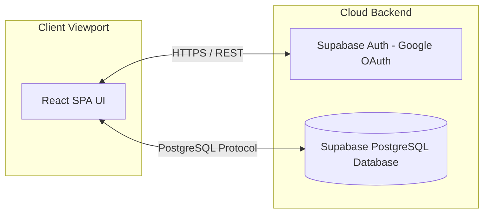

# IEEE Std 830-1998 Software Requirements Specification (SRS)
## Project: DreamSpace Portfolio Voting System

---

## 1. Introduction

### 1.1 Purpose
The purpose of this document is to define the complete software requirements for the **DreamSpace Portfolio Voting System**. This specification is intended for the project stakeholders, development team (database engineer, frontend developers), and the quality assurance tester.

### 1.2 Scope
This system manages the collection of portfolio websites submitted by students and staff of DreamSpace Academy and coordinates a 3-tier ranked voting process.
*   **Included:** Domain-locked Google OAuth authentication, administrator-created username/password credentials for students without access to `@dreamspace.academy` domain emails, portfolio submission/updating, ranked-choice ballot casting, admin toggle for results release, and dynamic scoreboard display.
*   **Excluded:** Direct portfolio hosting (only URLs are collected), custom self-signup email registration (only Google OAuth and admin-provisioned accounts are permitted).

### 1.3 Definitions, Acronyms, and Abbreviations
*   **IEEE:** Institute of Electrical and Electronics Engineers.
*   **SRS:** Software Requirements Specification.
*   **OAuth:** Open Authorization.
*   **RLS:** Row Level Security in PostgreSQL.
*   **Vite:** A frontend build tool that is lightweight and fast.
*   **Supabase:** Backend-as-a-Service using PostgreSQL.

### 1.4 References
*   IEEE Std 830-1998, IEEE Recommended Practice for Software Requirements Specifications.
*   Supabase JS Client SDK Reference.
*   DreamSpace Academy Brand Identity Manual (Colors: Purple and Orange).

### 1.5 Overview
The remainder of this document is organized into two main sections. Section 2 provides a high-level, overall description of the product perspective, functions, user characteristics, and design constraints. Section 3 outlines the specific functional, external interface, and non-functional requirements in detail.

---

## 2. Overall Description

### 2.1 Product Perspective
The DreamSpace Portfolio Voting System is a new, standalone web-based software product. It connects to a cloud database (Supabase) and is hosted on Vercel.

### 2.2 Product Functions
*   **Authentication & Guarding:** Google Sign-in restricted to `@dreamspace.academy` domains.
*   **Submission management:** Creation and updates of candidate portfolios.
*   **Ranked Voting:** Selection of 1st, 2nd, and 3rd choices with point weights of 5, 3, and 2 respectively.
*   **Results Aggregation:** Realtime tallying visible to administrators, and visible to users only after admin release.

### 2.3 User Classes and Characteristics
*   **Student (Voter / Candidate):** Students of DreamSpace Academy who upload their portfolio site details and have voting rights. They require a simple, mobile-optimized experience.
*   **Staff (Monitor):** Staff members of DreamSpace Academy who have rights to monitor activities. Staff do not have voting rights or portfolio uploading rights, and their account must be approved by an Administrator before they are granted access to monitor activities.
*   **Administrator:** Core organizers who manage setting configurations (releasing results), approve pending staff accounts, and need access to overall voting tallies.

### 2.4 Operating Environment
*   **Client OS:** Windows, macOS, iOS, Android.
*   **Browsers:** Chrome, Safari, Edge, Firefox (latest 2 versions).
*   **Database:** Supabase PostgreSQL cloud environment.

### 2.5 Design and Implementation Constraints
*   **Color Theme:** Strictly Light Theme matching the Purple (`#7B1FA2`) and Orange (`#FF6F00`) brand palette.
*   **Code limitations:** Vanilla CSS variables only (no Tailwind CSS framework).
*   **Domain limitation:** Non `@dreamspace.academy` users must be rejected at the boundary, unless they are using login credentials (username/password) manually provisioned by an Administrator.

### 2.6 Assumptions and Dependencies
*   Assumes Google OAuth API services are operational.
*   Assumes database operations run on standard Supabase SLA response parameters.

---

## 3. Specific Requirements

### 3.1 External Interface Requirements

#### 3.1.1 User Interfaces
*   **Responsive layouts:** Auto-fitting grids adapting from Mobile (`<768px`) to Desktop (`>1024px`).
*   **Interactive Target size:** Minimum size of `44px x 44px` for all clickable/tappable elements.
*   **Transitions:** CSS transitions must complete in `200ms` with `cubic-bezier(0.4, 0, 0.2, 1)`.

#### 3.1.2 Hardware Interfaces
No dedicated hardware interfaces required. The product runs on standard network-connected smartphones, tablets, and desktop devices.

#### 3.1.3 Software Interfaces
*   **OS/Browser API:** Web Cryptography API for session handling.
*   **Database Interface:** PostgreSQL dialect over Supabase client.

#### 3.1.4 Communications Interfaces
*   Communication between client browser and backend runs over HTTPS (port 443) using JSON payload serialization.

---

### 3.2 System Features / Functional Requirements

#### 3.2.1 Gated Auth, Credentials & Onboarding Flow
*   **Description:** Provide domain-gated Google OAuth for regular members, and username/password login for admin-provisioned students who lack `@dreamspace.academy` emails.
*   **Functional Actions:**
    *   **Dual Login Interface:** The Login Page must provide:
        1. A "Sign in with Google" button.
        2. Username (or Email) and Password input fields with a "Login" submit button.
    *   **Google Sign-In Path:**
        *   Initiate Google Sign-In redirect.
        *   Verify domain matching (`@dreamspace.academy`). If invalid, reject session and sign out.
        *   Check database for existing user profile:
            *   If profile exists, redirect to appropriate workspace based on role and approval status.
            *   If profile does not exist, display **Role Selection Dialog** (Student/Staff) and register them.
    *   **Credentials Login Path (Students & Admins):**
        *   Authenticate user via Supabase using the provided Username/Email and Password.
        *   Retrieve profile record from database.
        *   Bypass the `@dreamspace.academy` domain restriction checks if the profile's `is_admin_created` flag is set to `true` OR if they are an Admin (`is_admin = true` or `role = 'admin'`).
        *   If the user is an Admin, redirect directly to the Admin Dashboard.
        *   If the user is an admin-created Student, redirect directly to the Student Dashboard.
    *   **Credentials Provisioning:**
        *   Admin logs in, accesses the Admin Dashboard.
        *   Admin submits a form with Email (representing the username/login), Password, and Full Name.
        *   System registers the account with `role = 'student'`, `role_approved = true`, and `is_admin_created = true` in the database.

#### 3.2.2 Portfolio Upload & Management
*   **Description:** Create/Edit portfolio links. Restrict access to approved Students.
*   **Functional Actions:**
    *   Form validation for Title, Description, and link syntax.
    *   Verify active user has `role = 'student'` and `role_approved = true`.
    *   Prevent double portfolio uploads per profile (enforced by database constraint).
    *   Block staff and unapproved users from uploading or modifying portfolios.

#### 3.2.3 Three-Tier Ranked Voting
*   **Description:** Ranked voting logic. Restrict voting to approved Students.
*   **Functional Actions:**
    *   Verify active user has `role = 'student'` and `role_approved = true`.
    *   Save voter ballots for 1st (5 pts), 2nd (3 pts), and 3rd (2 pts) choices.
    *   **Strict Anonymity:** Ensure that no one (including staff and administrators) has access to view who voted for which portfolio. RLS policies must block reading other users' votes.
    *   Block voting for the same candidate multiple times.
    *   Allow users to vote for their own portfolio.
    *   Block staff, admins, and unapproved users from casting votes.

#### 3.2.4 Activity Monitoring (Staff/Admin)
*   **Description:** Monitor dashboard metrics and system activity. Restrict to approved Staff and Admins.
*   **Functional Actions:**
    *   Verify active user has (`role = 'staff'` and `role_approved = true`) or `is_admin = true`.
    *   Display live metrics (total voter turnout count, list of uploaded portfolios, total votes cast).
    *   **Enforce Anonymity:** Ensure staff and admins cannot view which student voted for which portfolio. They can only see aggregate statistics (e.g. list of profiles who have cast a vote, but not their choices).
    *   If results are not released, hide the scoreboard from general users but allow approved staff and admins to monitor aggregate progress.

#### 3.2.5 Admin Toggle & Live Leaderboard
*   **Description:** Aggregating scores and approving staff roles.
*   **Functional Actions:**
    *   Admin toggles database value `results_released` between `true`/`false`.
    *   If `true`, the Leaderboard is displayed to all authorized roles.
    *   **Scoreboard Display:** The scoreboard must **only** render the total points for each portfolio, ordered from highest points to lowest points. Individual ballots or who-voted-for-whom details are strictly hidden.
    *   `Score = (Votes_Rank1 * 5) + (Votes_Rank2 * 3) + (Votes_Rank3 * 2)`.
    *   Admin reviews list of pending staff sign-ups (where `role = 'staff'` and `role_approved = false`) and accepts/approves their access, which updates `role_approved = true`.

---

### 3.3 Performance Requirements
*   **Response Time:** Client-side updates should take `<100ms`. Supabase API calls must execute in under `300ms` under average connection parameters.
*   **Simultaneous Connections:** Supported load up to 100 concurrent voters without performance degradation.

### 3.4 Logical Database Requirements
*   Refer to schema specifications in [docs/database.md](file:///c:/Users/Paul-Rajeevan/Desktop/Voting/docs/database.md).

### 3.5 Design Constraints
*   **Light Theme Only:** Disable browser dark mode adaptations using styling override rules.

### 3.6 Software System Non-Functional Attributes

#### 3.6.1 Security & Access Control
*   **RLS Access control:** Profiles, Portfolios, and Votes must verify write authorizations based on the active JWT user UUID (`auth.uid()`).
    *   **Profiles:** Authenticated users can write only their own profile data. Admins can update any profile (e.g. to toggle `role_approved = true`). The `is_admin` and `is_admin_created` flags cannot be self-modified.
    *   **Portfolios:** Inserts and updates restricted to profiles where `role = 'student'` and `role_approved = true`.
    *   **Votes — Strict Anonymity:** Individual ballot rows are **never exposed** to any user other than the voter themselves. No user — including staff or administrators — can query the raw `votes` table for other users' data. All monitoring stats and the public scoreboard are served exclusively through database aggregate views (`public.voting_stats`, `public.results_view`).
    *   **Scoreboard Output:** The `public.results_view` exposes only: `portfolio title` and `total_points`. Results are ordered by `total_points DESC`. No voter identity, rank choice, or individual ballot data is included.
    *   **Staff Restriction:** Users with `role = 'staff'` are denied all insert/update access on `portfolios` and `votes`. Approved staff may only access aggregate views — never raw ballot data.
*   **Admin Credentials:** Administrators can log in using a pre-configured username (email) and password via Supabase Auth. Admin accounts bypass the `@dreamspace.academy` domain check at the auth layer.
*   **Domain Guarding:** Triggers on table level reject inserts from emails without the target domain suffix (`@dreamspace.academy`), unless `is_admin_created = true` is set on the profile.

#### 3.6.2 Portability
*   The application must compile and build cleanly to a static distribution bundle via Vite configuration for Vercel deployment.
